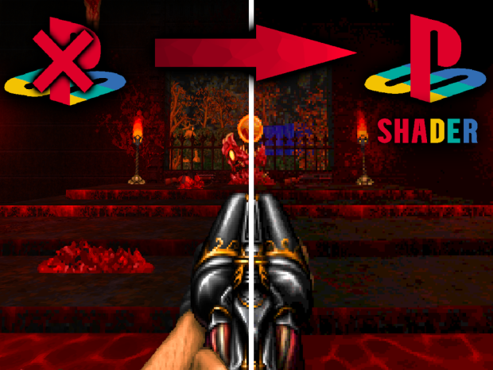

# PS1 SHADER MOD — PlayStation 1 Style Shader
for GZDoom / UZDoom

## ABOUT

This mod adds a post-process visual effect that mimics the  
look of PlayStation 1 graphics. You'll see the characteristic  
texture wobble and distortion, geometry pixelation, and  
dithering grain that made 90s games so recognizable.

The mod works on top of any WAD and does not change gameplay  
— visuals only.

## SETTINGS

Open the menu: **Options → PS1 Shader Options**

### MASTER

**Enable PS1 Shader**  
On / Off — master switch for the entire shader.  
Turn off to get a completely normal picture.

### EFFECTS — individual effects

**Affine Texture Mapping**  
The main PS1 effect. Textures on walls, floors and  
ceilings subtly "swim" and warp, most noticeable on  
large flat surfaces. This happened on PS1 because  
the hardware lacked perspective-correct texturing.

**Vertex Snapping**  
Geometry snaps to a pixel grid. When you move the  
camera, you can see a slight jitter on object edges  
— exactly how PS1 games looked.

**Dithering**  
Adds a fine checkerboard grain to the image. PS1  
used this to compensate for its limited color range.  
Most visible in dark areas.

### PARAMETERS — fine tuning

**Snap Grid Resolution**  
The pixel grid resolution for Vertex Snapping.  
Lower numbers mean larger pixels and more visible  
jitter.

- 480p — barely noticeable  
- 360p — subtle  
- 320p — SNES-like  
- 240p — PS1-accurate ← recommended  
- 160p — coarse  
- 120p — very coarse  
- 80p  — extreme  
- 60p  — maximum pixelation  

**Affine Warp Strength**  
How strong the texture distortion is (0.0 — 1.0).

- 0.0 — effect disabled  
- 0.3 — light wobble  
- 0.7 — noticeable effect  
- 1.0 — full PS1 style ← recommended  

**Color Depth Reduction**  
Reduces the number of colors, like old hardware.

- Off       — full color (no effect)  
- 64 shades — barely noticeable reduction  
- 32 shades — slight posterization  
- 16 shades — PS1-accurate ← recommended  
- 8 shades  — heavy posterization  
- 4 shades  — extreme  

## RECOMMENDED SETTINGS

**Default settings:**
- Affine Texture Mapping — On
- Vertex Snapping        — On
- Dithering              — On
- Snap Grid Resolution   — 240p (PS1)
- Affine Warp Strength   — 1.0
- Color Depth Reduction  — 16 shades (PS1)

**For a subtle, non-intrusive effect:**
- Affine Texture Mapping — On
- Vertex Snapping        — Off
- Dithering              — Off
- Snap Grid Resolution   — 320p
- Affine Warp Strength   — 0.4
- Color Depth Reduction  — Off

## COMPATIBILITY

- GZDoom 4.3.3 and newer
- UZDoom 4.14 and newer
- Works with any WAD and other mods
- Requires hardware (OpenGL / Vulkan) renderer  
  Software renderer is not supported

## RESET TO DEFAULTS

At the bottom of the PS1 Shader Options menu there is a  
"Reset to Defaults" button — it will restore all settings  
to their original values.